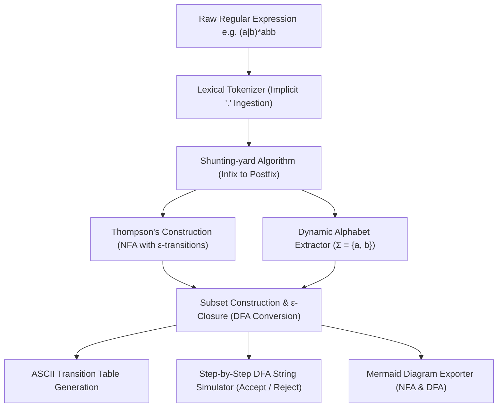
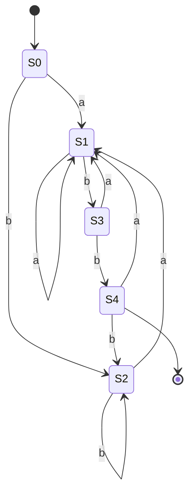

# ⚙️ Regex to NFA & DFA Automata Engine

[](https://www.oracle.com/java/)
[](#-algorithmic-architecture)
[](LICENSE)
[](#-getting-started)

A robust, end-to-end Computer Science engine that converts **Regular Expressions** into **Non-deterministic Finite Automata (NFA)** using **Thompson's Construction**, transforms them into **Deterministic Finite Automata (DFA)** using **Subset Construction ($\epsilon$-closure)**, and provides an interactive string matching and simulation engine.

---

## 📑 Table of Contents
- [Architecture & Pipeline](#-algorithmic-architecture)
- [Supported Regular Expression Operators](#-supported-regular-expression-operators)
- [Key Features](#-key-features)
- [Algorithmic Core](#-algorithmic-core)
  - [1. Lexical Tokenization & Implicit Concatenation](#1-lexical-tokenization--implicit-concatenation)
  - [2. Infix to Postfix (Shunting-yard Algorithm)](#2-infix-to-postfix-shunting-yard-algorithm)
  - [3. Thompson's Construction (Regex $\to$ NFA)](#3-thompsons-construction-regex--nfa)
  - [4. Subset Construction & $\epsilon$-Closure (NFA $\to$ DFA)](#4-subset-construction--epsilon-closure-nfa--dfa)
  - [5. Deterministic Pattern Matching & Simulation](#5-deterministic-pattern-matching--simulation)
- [Sample Execution & Transition Table](#-sample-execution--transition-table)
- [Interactive Visual Automata Diagrams (Mermaid)](#-interactive-visual-automata-diagrams)
- [Automated Verification Suite](#-automated-verification-suite)
- [Getting Started](#-getting-started)
- [Project Structure](#-project-structure)

---

## 🧠 Algorithmic Architecture



---

## 🔣 Supported Regular Expression Operators

| Operator | Notation | Precedence | Description | Example |
| :---: | :---: | :---: | :--- | :--- |
| **Kleene Star** | `*` | 3 (Highest) | Matches **0 or more** occurrences of the preceding element | `a*` matches `""`, `"a"`, `"aaa"` |
| **Positive Closure** | `+` | 3 (Highest) | Matches **1 or more** occurrences of the preceding element ($A^+ = A \cdot A^*$) | `a+` matches `"a"`, `"aa"` (not `""`) |
| **Optional** | `?` | 3 (Highest) | Matches **0 or 1** occurrence of the preceding element | `(cat)?` matches `""` or `"cat"` |
| **Concatenation** | `.` | 2 | Implicitly injected between adjacent matching elements | `ab` $\to$ `a . b`, `(a|b)*a` $\to$ `(a|b)* . a` |
| **Alternation / Union**| `\|` | 1 (Lowest) | Matches either the left or right subexpression | `a\|b` matches `"a"` or `"b"` |
| **Grouping** | `( )` | Overrides | Groups subexpressions to define evaluation order | `(a\|b)*abb` |

---

## 🌟 Key Features

1. **Automatic Concatenation Detection:**
   No need to manually type `a.b.c`. The tokenizer automatically inserts explicit concatenation symbols (`.`) between adjacent alphanumeric tokens, parentheses, and repetition operators.
2. **Dynamic Alphabet Discovery:**
   Extracts active terminal symbols directly from the expression. Works with any character set (digits, letters, words) without hardcoded alphabet tables.
3. **Thompson's Construction Primitives:**
   Implements composable atomic state machines for literals, empty transitions ($\epsilon$), union, concatenation, Kleene star, plus, and optional operators.
4. **Subset Construction with $\epsilon$-Closure:**
   Converts multi-state non-deterministic transitions into a deterministic, single-transition-per-symbol DFA with clean state labeling (`S0`, `S1`, `S2`...).
5. **Interactive String Simulator:**
   Steps through candidate strings symbol by symbol, tracing the state transitions and reporting whether each string is **ACCEPTED** or **REJECTED** with detailed path diagnostics.
6. **Native Mermaid Diagram Export:**
   Outputs copy-pasteable [Mermaid](https://mermaid.js.org/) state diagram code rendered natively on GitHub and markdown visualizers.
7. **Built-in Verification Suite:**
   Includes automated unit tests verifying classic formal language patterns (`(a|b)*abb`, binary divisibility, `(cat|dog)?`, positive closures).

---

## 🔬 Algorithmic Core

### 1. Lexical Tokenization & Implicit Concatenation
The `Tokenizer` processes the input character-by-character, discarding whitespace and evaluating adjacent token pairs $(t_1, t_2)$. An explicit concatenation operator (`.`) is inserted whenever:
- $t_1$ is an alphanumeric literal, `)`, `*`, `+`, or `?`
- **AND** $t_2$ is an alphanumeric literal or `(`

### 2. Infix to Postfix (Shunting-yard Algorithm)
Uses Dijkstra's Shunting-yard algorithm adapted for formal language grammars. Unary postfix operators (`*`, `+`, `?`) bind with highest precedence, followed by concatenation (`.`), then alternation (`|`).

### 3. Thompson's Construction (Regex $\to$ NFA)
Evaluates the postfix token queue using a stack of NFA fragments:
- **Symbol $c$**: Creates $(s) \xrightarrow{c} (e^*)$
- **Union $A \mid B$**: Creates new start/end states with $\epsilon$-branches to $A$ and $B$.
- **Concatenation $A \cdot B$**: Merges $A.end \xrightarrow{\epsilon} B.start$.
- **Star $A^*$**: Adds loopback $A.end \xrightarrow{\epsilon} A.start$ and bypass $s \xrightarrow{\epsilon} e$.
- **Plus $A^+$**: Adds loopback $A.end \xrightarrow{\epsilon} A.start$ while requiring at least one traversal.
- **Optional $A^?$**: Adds bypass $s \xrightarrow{\epsilon} e$ without loopback.

### 4. Subset Construction & $\epsilon$-Closure (NFA $\to$ DFA)
- **$\epsilon$-Closure($T$):** Traverses all states reachable from state subset $T$ via $\epsilon$-transitions using a stack.
- **Move($T, c$):** Finds all states directly reachable on symbol $c$ from states in $T$.
- Each unique subset of NFA states forms a single deterministic DFA state. A DFA state is accepting if its underlying subset contains any NFA final state.

---

## 📊 Sample Execution & Transition Table

Given the regular expression `(a|b)*abb` (strings ending in `"abb"`):

```text
[Step 1] Infix Token Queue  : [(, a, |, b, ), *, ., a, ., b, ., b]
[Step 2] Postfix Token Queue: [a, b, |, *, a, ., b, ., b, .]
         Postfix String     : a b | * a . b . b .
[Step 3] Active Alphabet (Σ): [a, b]

[Step 4] Thompson's Construction (NFA)
  Start State: q6
  Final State: q13

--- NFA Transitions ---
  q6   -----( ε )-----> q4  
  q4   -----( ε )-----> q0  
  q0   -----( a )-----> q1  
  q1   -----( ε )-----> q5  
  q5   -----( ε )-----> q4  
  q5   -----( ε )-----> q7  
  q7   -----( ε )-----> q8  
  q8   -----( a )-----> q9  
  q9   -----( ε )-----> q10 
  q10  -----( b )-----> q11 
  q11  -----( ε )-----> q12 
  q12  -----( b )-----> q13 
  q4   -----( ε )-----> q2  
  q2   -----( b )-----> q3  
  q3   -----( ε )-----> q5  
  q6   -----( ε )-----> q7  

[Step 5] Subset Construction (NFA -> DFA)

+-------------------------------------------------------------------------+
|                           DFA TRANSITION TABLE                          |
+-------------------------------------------------------------------------+
| DFA State    | NFA Subset         | 'a'   | 'b'   | Accepting? |
+--------------+--------------------+-------+-------+------------+
| ->   S0      | [0, 2, 4, 6, 7, 8] | S1    | S2    | no         |
|      S1      | [0, 1, 2, 4, 5, 7, 8, 9, 10] | S1    | S3    | no         |
|      S2      | [0, 2, 3, 4, 5, 7, 8] | S1    | S2    | no         |
|      S3      | [0, 2, 3, 4, 5, 7, 8, 11, 12] | S1    | S4    | no         |
|    * S4      | [0, 2, 3, 4, 5, 7, 8, 13] | S1    | S2    | YES        |
+--------------+--------------------+-------+-------+------------+
Legend: '->' = Start State, '*' = Accepting State, '-' = Reject / Dead State

[Step 6] Test Strings Against DFA
  --- Simulating String: "abb" ---
  Initial State: S0 
  Step 1: 'a' -> S1 
  Step 2: 'b' -> S3 
  Step 3: 'b' -> S4 (Accepting)
  ==> Match Result: ACCEPTED ✅ (Halted at accepting state S4)

  --- Simulating String: "ab" ---
  Initial State: S0 
  Step 1: 'a' -> S1 
  Step 2: 'b' -> S3 
  ==> Match Result: REJECTED ❌ (Halted at non-accepting state S3)
```

---

## 🎨 Interactive Visual Automata Diagrams

### Generated DFA for `(a|b)*abb`


---

## 🧪 Automated Verification Suite

Run Option 2 from the main menu to execute automated verification of regex patterns and string accept/reject assertions:

```text
Executing automated test suite...

Testing Regex: "(a|b)*abb"
  ==> PASSED (All positive & negative matches verified) ✅
Testing Regex: "(0|1)*1"
  ==> PASSED (All positive & negative matches verified) ✅
Testing Regex: "a*b+"
  ==> PASSED (All positive & negative matches verified) ✅
Testing Regex: "(cat|dog)?"
  ==> PASSED (All positive & negative matches verified) ✅
Testing Regex: "a(b|c)*d"
  ==> PASSED (All positive & negative matches verified) ✅

--------------------------------------------------
Test Results: 5 Passed, 0 Failed (Total 5)
STATUS: ALL TESTS PASSED! 🎉
--------------------------------------------------
```

---

## 🚀 Getting Started

### Prerequisites
- Java JDK 8 or higher (Tested on Java 8, 11, 17, 21, and 25)

### Running via Command Line
```bash
# Clone the repository
git clone https://github.com/mohamed-zizo-sketch/regex-to-dfa-automata-engine.git
cd regex-to-dfa-automata-engine

# Compile all source files
javac -d build/classes src/toc/*.java

# Run interactively
java -cp build/classes toc.Toc

# Or pass a regex directly via argument:
java -cp build/classes toc.Toc "(a|b)*abb"
```

### Running in NetBeans IDE
1. Open NetBeans IDE.
2. Select **File** $\to$ **Open Project...**
3. Select this repository folder.
4. Press **F6** or click the **Run Project** button.

---

## 📁 Project Structure

```text
regex-to-dfa-automata-engine/
├── src/
│   └── toc/
│       ├── Toc.java                 # Interactive CLI driver and entry point
│       ├── Tokenizer.java           # Lexical analysis & implicit concatenation
│       ├── InfixToPostfix.java      # Shunting-yard algorithm
│       ├── State.java               # Atomic NFA state with transitions & unique IDs
│       ├── NFA.java                 # Thompson's Construction primitives
│       ├── RegexToNFAManager.java   # Postfix-to-NFA parsing & Mermaid export
│       ├── DFAState.java            # DFA subset representation
│       ├── DFA.java                 # DFA transition table, simulator, & Mermaid
│       ├── NFAToDFAConverter.java   # Subset Construction with ε-closure
│       ├── AutomataTestSuite.java   # Regression test suite
│       ├── queue.java               # Custom linked-list FIFO Queue
│       ├── stack.java               # Custom linked-list LIFO Stack
│       └── Node.java                # Linked node data structure
├── .gitignore                       # Clean repository exclusions
├── build.xml                        # Ant build script
└── README.md                        # Documentation & architecture guide
```

---

## 📄 License
This project is open-source under the [MIT License](LICENSE).
